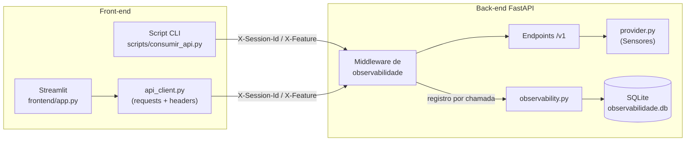

# 📡 Sensor Monitoring API — Forzy · Digital Twin

Checkpoint integrado **Governança em IA + Front-end** (Tecnólogo em IA).

API em **FastAPI** que expõe o provider de **Sensores** (leitura atual e histórico) e registra, a cada chamada, os metadados de observabilidade definidos no *Metric Contract* da disciplina de Governança em IA. Os dados são consumidos via **requests** por um script de linha de comando e por uma interface **Streamlit**.

## 👥 Integrantes

| Nome | RM |
|---|---|
| Matheus Cardoso | RM 564898 |
| Caique Sousa | RM 563621 |
| Paulo Gabriel | RM 566446 |
| William Stahl | RM 562800 |
| Lucas Gambini | RM 564750 |

## 🏗️ Arquitetura



**Fluxo de uma chamada**

1. O front envia `GET` com os headers de contexto `X-Session-Id` (sessão do usuário) e `X-Feature` (funcionalidade/aba de origem).
2. O **middleware** gera um `request_id`, mede a latência e, ao final, grava um registro no SQLite com: timestamp UTC, método, rota, tag, session_id, feature, status HTTP, latência (ms), *freshness* (s), completude (%), severidade e se a chamada cumpriu o contrato (headers presentes).
3. A resposta devolve `X-Request-Id` e `X-Response-Time-ms` para rastreabilidade ponta a ponta.
4. `GET /v1/observabilidade` expõe os registros e um **resumo agregado** (p50/p95 de latência, taxa de erro, conformidade de headers, freshness, completude), comparando cada indicador com seu limiar (`OK` / `VIOLADO`).

### Estrutura de pastas

```
sensor-monitoring-api/
├── backend/
│   ├── main.py            # app FastAPI, endpoints e middleware de observabilidade
│   ├── provider.py        # provider de Sensores (dados simulados determinísticos)
│   └── observability.py   # persistência SQLite + agregação do Metric Contract
├── frontend/
│   ├── app.py             # interface Streamlit
│   └── api_client.py      # cliente requests que injeta os headers de contexto
├── scripts/
│   └── consumir_api.py    # script de consumo dos 3 endpoints via requests
└── requirements.txt
```

## 🔌 Endpoints

| Funcionalidade | Endpoint | Consumo no front |
|---|---|---|
| Lista de sensores | `GET /v1/sensores` | Seletor de sensor |
| Leitura atual | `GET /v1/sensores/{tag}/leitura-atual` | Valor, severidade, freshness e gauge |
| Histórico | `GET /v1/sensores/{tag}/historico?horas=6` | Gráfico de linha + tabela + completude |
| Observabilidade | `GET /v1/observabilidade?limite=200&janela_min=60` | Metric Contract, gráficos e tabela de registros |
| Limpar registros | `DELETE /v1/observabilidade` | (uso em testes) |

Tags disponíveis: `TT-101` (temperatura), `VT-201` (vibração), `PT-301` (pressão), `FT-401` (vazão).

Documentação interativa (Swagger): http://127.0.0.1:8000/docs

## 📦 Pacotes necessários

Python **3.10+** e os pacotes do `requirements.txt`:

| Pacote | Uso |
|---|---|
| `fastapi` | framework da API |
| `uvicorn[standard]` | servidor ASGI |
| `requests` | consumo da API no front e no script |
| `streamlit` | interface web |
| `pandas` | manipulação dos dados na interface |
| `plotly` | gráficos interativos |

## ▶️ Como rodar localmente

```bash
# 1. clonar e entrar na pasta
git clone <URL_DO_REPOSITORIO>
cd sensor-monitoring-api

# 2. (opcional) ambiente virtual
python -m venv .venv
.venv\Scripts\activate        # Windows
# source .venv/bin/activate   # Linux/Mac

# 3. instalar dependências
pip install -r requirements.txt

# 4. subir a API (terminal 1)
uvicorn backend.main:app --reload --port 8000

# 5. subir a interface (terminal 2)
streamlit run frontend/app.py

# 6. (opcional) script de consumo via requests (terminal 3)
python scripts/consumir_api.py --tag TT-101 --chamadas 20
```

A interface abre em http://localhost:8501. Para apontar para outra URL de API, use a variável `SENSOR_API_URL` ou o campo na barra lateral.

### Exemplo com curl

```bash
curl -H "X-Session-Id: teste-01" -H "X-Feature: curl" http://127.0.0.1:8000/v1/sensores/TT-101/leitura-atual
```

## 📏 Metric Contract (resumo)

| Indicador | Limiar | Origem |
|---|---|---|
| Latência p95 | ≤ 300 ms | middleware |
| Taxa de erro 5xx | ≤ 1 % | middleware |
| Conformidade de headers | ≥ 99 % | middleware |
| Freshness da leitura atual (média) | ≤ 120 s | endpoint leitura-atual |
| Freshness em conformidade | ≥ 90 % das leituras ≤ 120 s | endpoint leitura-atual |
| Completude do histórico | ≥ 95 % | endpoint histórico |

Detalhamento completo (baselines, visualizações e planos de ação) no documento da disciplina de Governança em IA.

## 🚫 Fora do escopo deste checkpoint

- Autenticação/autorização (Sprint 4).
- Providers de Equipamentos e Plantas (Sprint 4).

## 🎥 Vídeo

Link do vídeo de demonstração: `<inserir link>`
